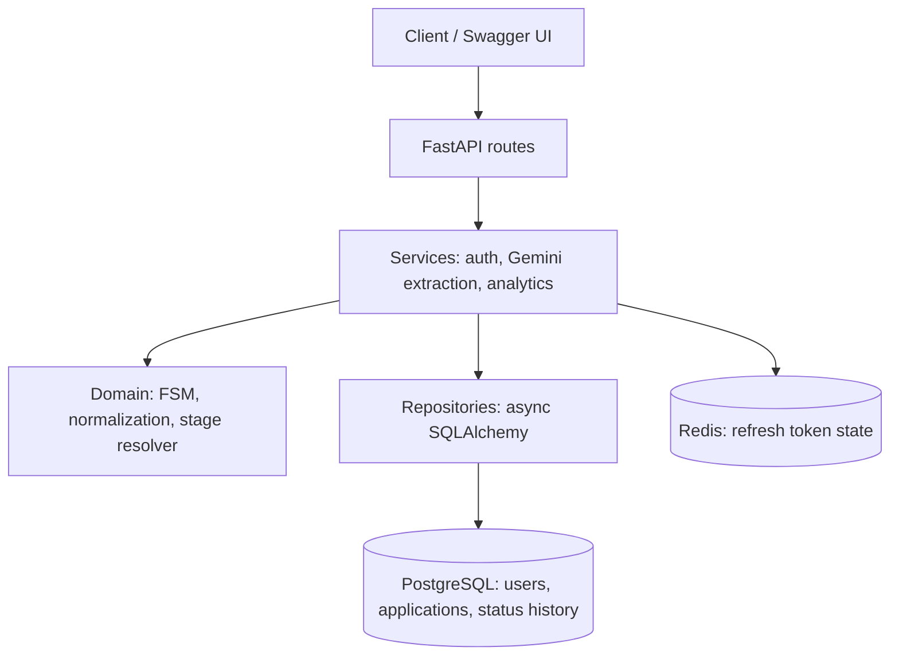
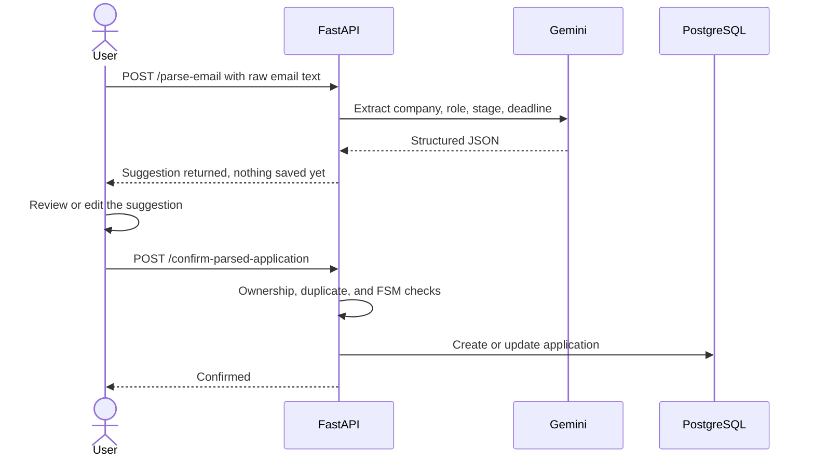
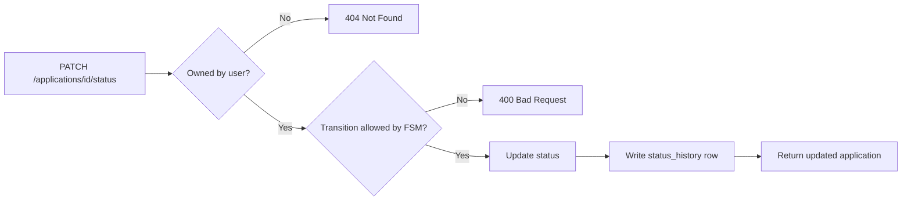
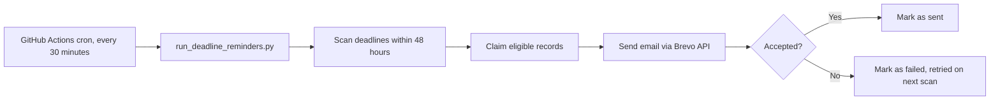
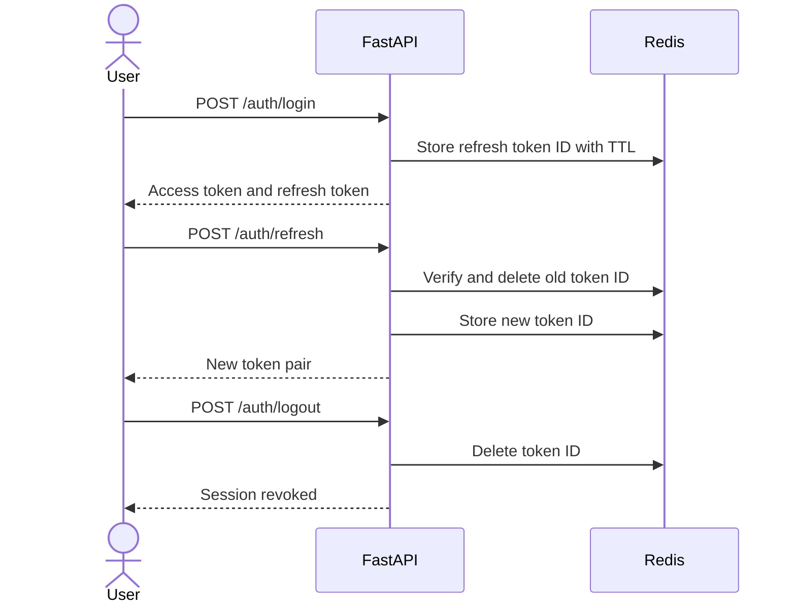

# Internship Application Tracker

A multi user REST API that replaces spreadsheet tracking for internship applications. It enforces valid hiring stage transitions with a finite state machine, extracts application details from pasted recruiter emails using an LLM, computes funnel analytics, and sends automated deadline reminders.
 


 
## Live Links
 
| Service | Link |
|---|---|
| Frontend (Vercel) | [Add Vercel URL here](https://your-app.vercel.app) |
| API (Render) | [Add Render URL here](https://your-api.onrender.com) |
| API Docs (Swagger UI) | [Add Render URL here, ending in /docs](https://your-api.onrender.com/docs) |
| Database (Supabase) | [Add Supabase project link here](https://supabase.com/dashboard/project/your-project-id) |

## Overview

Internship Application Tracker is a multi-user backend system for recording and monitoring internship applications. Each application belongs to an authenticated user and moves through a controlled hiring pipeline. The API validates status changes, records status history, computes user-specific analytics, and supports AI-assisted extraction of application details from pasted email content.

Deadline reminders are delivered by email through Brevo. The repository retains Celery-based background-task support for local development, while the intended low-cost deployment uses a scheduled GitHub Actions workflow to run the reminder scanner.

The project is intentionally backend-focused. API consumers can use the automatically generated Swagger UI; a frontend is not included in the current scope.

## Features

### Application management

- Create, retrieve, list, and update internship applications.
- Store company, role, current status, deadline, and other application details.
- Restrict application access to the authenticated owner.
- Track status changes in a separate history table.
- Validate lifecycle changes through a finite state machine rather than accepting arbitrary status updates.
- Normalize company names to uppercase and role titles to lowercase.

### Authentication and authorization

- User registration and login.
- JWT access and refresh tokens.
- Short-lived access tokens and longer-lived refresh tokens.
- Refresh-token rotation and Redis-backed refresh-token state.
- Ownership checks on application and parsed-application operations.

### AI-assisted email parsing

- Submit pasted recruitment email text to the Gemini API.
- Extract a company, role, hiring stage, and possible deadline.
- Return a suggestion without immediately creating or changing an application.
- Require a separate confirmation request before persisting the suggestion.
- Match an existing application by the authenticated user, normalized company name, and normalized role title.
- Reject duplicate parsed confirmations while allowing different roles at the same company.

### Analytics

The authenticated analytics endpoint computes metrics for the current user, including:

- Application counts by current status.
- Funnel conversion metrics derived from status history.
- Average elapsed time between status-history events.
- Ghosting rate.
- Response rate by company.

Analytics are computed on demand by the API. The endpoint does not depend on a shared, global analytics snapshot.

### Deadline reminders

- Identify applications with deadlines approaching within the reminder window.
- Track reminder processing states to reduce duplicate sends and support retrying failed work.
- Send reminders to the email address associated with the application owner.
- Deliver email through Brevo.
- Run the production reminder scanner on a GitHub Actions schedule.

## Tech Stack
 
| Area | Technology |
|---|---|
| Language | Python 3.12+ |
| API framework | FastAPI, Pydantic v2 |
| Database | PostgreSQL, SQLAlchemy 2.0 (async), Alembic |
| Auth and token state | JWT, bcrypt, Redis |
| AI extraction | Google Gemini API (structured JSON output) |
| Email | Brevo API |
| Background jobs | GitHub Actions cron (production), Celery with Beat (local) |
| Frontend | Vanilla HTML and JavaScript |
| Testing | pytest, pytest asyncio, httpx |
| Infrastructure | Docker Compose, GitHub Actions, Render, Vercel, Supabase |

## Architecture
 
The project uses a layered structure so HTTP handling, business rules, and database access stay separate and independently testable.
 

 
## Workflows
 
### Email parsing: suggest, review, confirm
 
The AI never writes to the database on its own. The user always reviews the extracted details first.
 

 
### Status transitions: validated and audited
 

 
### Deadline reminders: scheduled and retry safe
 

 
### Authentication: rotating refresh tokens
 

## Application Lifecycle

Application status is represented by the domain-level `ApplicationStatus` enum. The current statuses are:

- `APPLIED`
- `OA1`
- `OA2`
- `INTERVIEW`
- `OFFER`
- `REJECTED`
- `WITHDRAWN`
- `GHOSTED`

Allowed transitions are defined in the finite state machine (`app/domain/fsm.py`). The API rejects transitions that are not permitted by those rules. Status changes are recorded in `status_history`, allowing the system to retain the sequence and timing of an application's progress.

The API uses a dedicated status-transition endpoint so a normal application-field update cannot bypass the lifecycle rules.

## API Reference

All application, parsing, confirmation, and analytics operations require authentication. Register and login to obtain tokens, then send the access token using the `Authorization: Bearer <access_token>` header.

### Authentication

| Method | Endpoint | Description |
|---|---|---|
| `POST` | `/auth/register` | Register a user account. |
| `POST` | `/auth/login` | Authenticate and issue access and refresh tokens. |
| `POST` | `/auth/refresh` | Rotate a refresh token and issue a new token pair. |
| `POST` | `/auth/logout` | Revoke the supplied refresh token. |

### Applications

| Method | Endpoint | Description |
|---|---|---|
| `POST` | `/applications` | Create an application. |
| `GET` | `/applications` | List applications owned by the authenticated user. |
| `GET` | `/applications/{application_id}` | Retrieve one application owned by the user. |
| `PATCH` | `/applications/{application_id}` | Partially update editable application fields, including the deadline. |
| `PATCH` | `/applications/{application_id}/status` | Validate and record a status transition. |

### Email parsing

| Method | Endpoint | Description |
|---|---|---|
| `POST` | `/parse-email` | Extract a structured application suggestion from pasted email text. |
| `POST` | `/confirm-parsed-application` | Confirm a suggestion and create or update the matching application. |

### Analytics

| Method | Endpoint | Description |
|---|---|---|
| `GET` | `/analytics` | Compute analytics for the authenticated user. |

FastAPI exposes the interactive Swagger UI and OpenAPI schema when the API is running:

- Swagger UI: `http://127.0.0.1:8000/docs`
- ReDoc: `http://127.0.0.1:8000/redoc`
- OpenAPI JSON: `http://127.0.0.1:8000/openapi.json`

The route list above reflects the current documented API surface. Use `/docs` as the source of truth for request and response schemas.

## Email Parsing Workflow

`POST /parse-email` sends the supplied email text to Gemini and returns extracted fields such as company name, role title, stage, and deadline. The endpoint does not persist the extracted result.

The client should present the suggestion to the user for review. After the user confirms or edits the extracted values, it calls `POST /confirm-parsed-application`.

Confirmation behavior:

1. If an `application_id` is supplied, the API verifies that the application belongs to the authenticated user and applies the status update through the normal FSM path.
2. If no `application_id` is supplied, the API checks for an existing application with the same normalized company and role for that user.
3. If a duplicate is found, the API returns `409 Conflict` rather than creating another parsed application.
4. Otherwise, a new application is created and receives its database-generated ID.

Company names are normalized to uppercase and role titles to lowercase, with whitespace normalized before persistence and matching. The same company may therefore have multiple applications when the roles differ.

The human-confirmation step is intentional: AI extraction is a suggestion and should not silently create or modify application records.

## Analytics

`GET /analytics` calculates metrics from the authenticated user's application and status-history records. User scoping is applied during the calculations so one account's data is not included in another account's response.

The response contains a `data` object and a `computed_at` timestamp. The metrics include funnel counts, conversion rates, average time between status-history events, ghosting rate, and response rate by company.

Analytics are calculated on demand. This keeps the read path independent of a background analytics refresh schedule, at the cost of running the aggregation queries when the endpoint is requested.

## Deadline Reminder Workflow

The reminder scanner looks for eligible applications with deadlines in the next 48 hours. Reminder state is tracked on the application record so the scanner can distinguish pending, queued, sent, and failed work. Stale queued records can be recovered and failed reminders can be considered again by a later scan.

Reminder emails are sent through Brevo to the email address of the user who owns the application. `FROM_EMAIL` identifies the configured sender; there is no separate global notification recipient.

### Production scheduling

The repository includes:

- `scripts/run_deadline_reminders.py` — direct runner for a reminder scan.
- `.github/workflows/deadline-reminders.yml` — scheduled GitHub Actions workflow.

The workflow is configured to run approximately every 30 minutes. GitHub Actions scheduled jobs are best-effort and may start later than the cron time; this should not be treated as a real-time notification guarantee.

### Local Celery support

Celery task modules and a Celery Beat schedule are retained for local development and task testing. The selected low-cost deployment path uses the GitHub Actions runner for scheduled email processing instead of requiring a continuously running Celery worker and scheduler.

## Data Model

The main relational entities are:

| Entity | Purpose |
|---|---|
| `users` | Account identity, credentials, and application ownership. |
| `applications` | Company, role, current status, deadline, and notification processing state. |
| `status_history` | Append-only record of application status transitions and timestamps. |
| `analytics_snapshot` | Per-user analytics snapshot model retained for task-related functionality; the live `/analytics` endpoint computes its response on demand. |

Applications reference their owner through `user_id`. Status history is associated with an application. Database schema changes are managed using Alembic migrations.

## Project Structure

```text
.
├── app/
│   ├── api/              # FastAPI route handlers
│   ├── core/             # Settings, security, dependencies, Redis and Celery setup
│   ├── db/               # ORM models and database sessions
│   ├── domain/           # Status enum, FSM, normalization and stage resolution
│   ├── repositories/     # Database access operations
│   ├── schemas/          # Pydantic request and response schemas
│   ├── services/         # Authentication, Gemini extraction and analytics
│   ├── tasks/            # Celery deadline, notification and analytics tasks
│   └── main.py           # FastAPI application entry point
├── alembic/              # Alembic configuration and migration versions
├── scripts/
│   └── run_deadline_reminders.py
├── tests/                # Unit and API integration tests
├── .github/
│   └── workflows/
│       └── deadline-reminders.yml
├── .env.example
├── requirements.txt
└── README.md
```

## Local Development

### Prerequisites

- Python 3.12 or newer.
- Docker and Docker Compose.
- Git.
- Gemini API key for email parsing.
- Brevo API key and a configured sender email for reminder delivery.

PostgreSQL and Redis must be available locally or through managed services.

### 1. Clone the repository

```bash
git clone https://github.com/<your-username>/<repository-name>.git
cd <repository-name>
```

Replace the URL and directory name with your repository details.

### 2. Start local infrastructure

If your Compose configuration defines the local PostgreSQL and Redis services, start them with:

```bash
docker compose up -d
```

Check that the services are healthy before starting the API.

### 3. Create and activate a virtual environment

**Windows PowerShell**

```powershell
python -m venv .venv
.venv\Scripts\Activate.ps1
```

**macOS / Linux**

```bash
python -m venv .venv
source .venv/bin/activate
```

### 4. Install dependencies

```bash
python -m pip install --upgrade pip
pip install -r requirements.txt
```

### 5. Configure environment variables

Copy the example file:

**Windows PowerShell**

```powershell
Copy-Item .env.example .env
```

**macOS / Linux**

```bash
cp .env.example .env
```

Edit `.env` with your local database, Redis, JWT, Gemini, and Brevo settings. See [Environment Variables](#environment-variables).

### 6. Apply database migrations

```bash
alembic upgrade head
```

### 7. Start the API

```bash
uvicorn app.main:app --reload
```

The API runs at `http://127.0.0.1:8000` by default. Open `http://127.0.0.1:8000/docs` to register a test account and exercise the endpoints.

### 8. Run the tests

```bash
pytest -q
```

## Environment Variables

The application reads configuration from environment variables. Create `.env` locally from `.env.example`; never commit real credentials.

| Variable | Purpose |
|---|---|
| `DATABASE_URL` | PostgreSQL connection URL. The async application connection uses the `postgresql+asyncpg` driver form. |
| `REDIS_URL` | Redis connection used for refresh-token state and Celery configuration. |
| `JWT_SECRET_KEY` | Secret used to sign and verify JWTs. Use a long, random value. |
| `JWT_ALGORITHM` | JWT signing algorithm configured by the application. |
| `ACCESS_TOKEN_EXPIRE_MINUTES` | Access-token lifetime; the current project configuration uses 15 minutes. |
| `REFRESH_TOKEN_EXPIRE_DAYS` | Refresh-token lifetime; the current project configuration uses 7 days. |
| `GEMINI_API_KEY` | Credential for Gemini email extraction. |
| `GEMINI_MODEL` | Gemini model identifier used by the extraction service. |
| `BREVO_API_KEY` | Credential for sending deadline reminder emails through Brevo. |
| `FROM_EMAIL` | Sender address used for reminder emails. |


## Running Background Tasks Locally

For local development that uses the Celery queue, start a worker in one terminal:

```bash
celery -A app.core.celery_app worker --loglevel=info
```

Start Celery Beat in a separate terminal when you want to run the configured periodic schedule:

```bash
celery -A app.core.celery_app beat --loglevel=info
```

On Windows, Celery worker pool compatibility can vary. If the default worker pool does not start, try the solo pool:

```bash
celery -A app.core.celery_app worker --pool=solo --loglevel=info
```

To execute the direct reminder runner manually, with the required database and Brevo settings configured, use:

```bash
python -m scripts.run_deadline_reminders
```

The direct runner is the same entry point used by the scheduled GitHub Actions workflow.

## Testing

Run the full suite from the repository root:

```bash
pytest -q
```

The tests cover the main domain, repository, authentication, API, analytics, parsing, and background-task behavior. External services such as Gemini and Brevo should be mocked in automated tests rather than requiring live credentials or sending real emails.

The current development test suite has passed locally. Re-run the suite after changing code, configuration, or migrations; a previous passing result does not replace verification of a new commit.

## Deployment Design

The intended low-cost deployment separates the API from scheduled reminder execution:

| Component | Deployment responsibility |
|---|---|
| FastAPI service | Hosts the public API. |
| Managed PostgreSQL | Stores users, applications, status history, and reminder state. |
| Managed Redis | Supports refresh-token state and any deployed Celery functionality that is retained. |
| GitHub Actions | Runs the deadline reminder script on its configured schedule. |
| Gemini API | Extracts structured fields from user-submitted email text. |
| Brevo | Sends deadline reminder emails. |

The application can be hosted on a platform that supports a Python web service, with PostgreSQL and Redis supplied by managed services. Exact provider configuration, connection URLs, environment variables, and health checks should be confirmed during deployment.

### GitHub Actions secrets

Configure the repository secrets required by `.github/workflows/deadline-reminders.yml`. At minimum, the scheduled runner needs access to the production database and Brevo sender credentials. Add any additional settings that `app/core/config.py` validates at startup.

Do not put production secrets directly in workflow YAML or commit them to the repository.

## Deployment
 
| Component | Platform |
|---|---|
| Frontend | Vercel |
| API (FastAPI with Uvicorn) | Render |
| PostgreSQL | Supabase |
| Redis | Managed Redis instance for refresh token state |
| Reminders | GitHub Actions workflow (`.github/workflows/deadline-reminders.yml`) every 30 minutes, with secrets stored in repository settings |
 
Apply Alembic migrations to the production database before routing traffic to a new version.